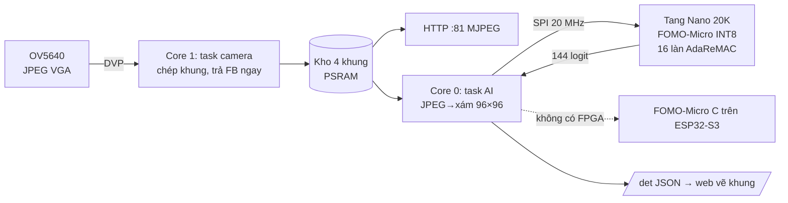

# README — Báo cáo Kỹ thuật Toàn diện Dự án AdaReMAC-EdgeVision v4.3

**Phát hiện người thời gian thực theo phương pháp FOMO trên ESP32-S3 N16R8 (OV5640) và bộ tăng tốc INT8 dùng bộ nhân xấp xỉ AdaReMAC trên Sipeed Tang Nano 20K**

Phiên bản 4.3 · 20/10/2026 · thay thế báo cáo v3 (đã chuyển vào `legacy/docs_v3/`)

---

## Tóm tắt

Bản v4 làm lại phần nhận dạng từ gốc theo đúng quy trình phát hiện đối tượng FOMO của Edge Impulse: ảnh xám 96×96 → mạng tích chập cắt ở stride 8 → bản đồ nhiệt tâm đối tượng 12×12 → gộp ô kề nhau thành đối tượng. Mô hình được huấn luyện trên dữ liệu **đã gán nhãn sẵn** của COCO 2017 (lớp *person*), không gán nhãn tay.

Cùng một mô hình INT8 (FOMO-Micro, 4,15 triệu phép MAC/khung, 24,5 nghìn tham số) chạy được ở ba nơi và cho kết quả **trùng khớp từng bit**: mô hình tham chiếu Python, mã C trên ESP32-S3, và bộ tăng tốc RTL trên Tang Nano 20K. Mô phỏng RTL cho thấy bộ tăng tốc cần **350.784 chu kỳ (12,99 ms ở 27 MHz)** mỗi khung. Cộng thời gian truyền SPI 20 MHz (3,69 ms), giới hạn trên là khoảng 60 khung/s, đủ cho mục tiêu ≥ 30 khung/s.

Trên tập COCO val 2017 (4.535 ảnh), FOMO-Micro INT8 đạt F1 theo tâm đối tượng **0,307** (0,401 nếu tính tâm rơi trong khung người). Mức này ngang FOMO MobileNetV2-0.35 huấn luyện cùng điều kiện (0,298) và gần mô hình thầy 21 triệu MAC (0,347). Chuyển toàn bộ mạng sang Mode 0 (xấp xỉ) của AdaReMAC làm F1 thay đổi +0,002, tức không đáng kể. Cần nói thẳng: trên COCO, độ chính xác ở mức ảnh **chưa đủ để làm báo động** (ở 10% báo động giả, recall khoảng 31%). Lý do là COCO khó hơn nhiều so với một cảnh camera cố định. Firmware và dữ liệu vì vậy đi kèm quy trình tinh chỉnh theo cảnh lắp đặt bằng nhãn tự động (mục 3.4); đây là bước quyết định độ chính xác khi triển khai.

Vấn đề OV5640 quá nhiệt được phân tích từ cơ chế cấp nguồn lõi qua LDO nội. Báo cáo đề xuất các biện pháp **chỉ bằng phần mềm**: giảm thời gian hoạt động, giảm xung nhịp, dòng chân I/O và công suất phát Wi-Fi. Các biện pháp đã có trong firmware; **mức giảm nhiệt độ thực tế chưa đo** và cần nhóm đo theo quy trình ở mục 7.5.

---

## 1. Rà soát bản v3: các vấn đề tồn đọng

Bản handover v3 có nhiều khẳng định không được mã nguồn hay dữ liệu chứng minh. Bảng dưới liệt kê từng vấn đề, bằng chứng trong code v3, và cách v4 xử lý.

| # | Khẳng định trong v3 | Thực tế trong mã nguồn v3 | Xử lý ở v4 |
|---|---|---|---|
| 1 | "Triển khai Edge Impulse FOMO + Tiny-SSD" | `analyze_frame_fomo_pipeline()` là trừ nền kiểu ViBe trên lưới 20×15 với 16 đặc trưng thủ công (độ sáng, sắc độ, biên). Không có mạng CNN nào chạy trên điểm ảnh. | Thay bằng FOMO thật: CNN trên ảnh xám 96×96, cắt stride 8, đầu ra 12×12 (mục 4) |
| 2 | "12.000 mẫu đã gán nhãn, độ chính xác 99,97%" | `build_prelabeled_fomo_ssd_dataset_and_train()` sinh đặc trưng bằng `rng.uniform` theo khoảng định sẵn cho từng lớp. Mô hình học lại chính quy tắc sinh dữ liệu, nên con số này không có ý nghĩa. | Dùng COCO 2017 do con người gán nhãn; báo cáo F1 trên COCO val (tập không dùng để chọn tham số) |
| 3 | "CNN đạt 100% trên tập kiểm thử" | `synthesize_canonical_digits()` sửa từng ảnh test bằng gradient **cho tới khi mô hình đoán đúng** (tối đa 12 vòng), và chỉ có 20 mẫu. | Bỏ. Phần đánh giá MNIST thật trong `ai_eval/` (đạt 98,5%) được giữ nguyên |
| 4 | "Trích trọng số FOMO pre-trained của Edge Impulse" | Ma trận 3×32 của mô hình *box/earbuds* (đầu vào là 48 kênh đặc trưng MobileNet) bị áp lên 16 đặc trưng thủ công khác hoàn toàn. Thêm vào đó, tệp `models/ei-...zip` không có trong repo và đường dẫn bị gán cứng `C:/Users/nhath/...`. | Bỏ. Học chuyển giao đúng nghĩa: backbone MobileNetV2 tiền huấn luyện ImageNet làm mô hình thầy (mục 4.2) |
| 5 | "Hồi quy khung bao Tiny-SSD" | Nhãn hộp là công thức tự đặt (`0.16*f[9] + 0.10*f[11]`), không phải hộp thật. | Bỏ. FOMO không học kích thước; v4 nói rõ giới hạn này |
| 6 | "Đồng xử lý FOMO trên FPGA qua SPI 0x30..0x37" | Mỗi phép MAC cần 2 giao dịch SPI ở 2 MHz (khoảng 16 µs), chậm hơn ESP32 tự tính hàng nghìn lần. SPI slave cũ lấy mẫu SCLK bằng xung 27 MHz nên SCLK tối đa khoảng 4 MHz. | Bộ tăng tốc nhận cả khung ảnh, tự chạy toàn bộ mạng, trả về bản đồ 12×12; SPI 20 MHz (mục 6) |
| 7 | "AI < 1,25 ms, stream 32–36 fps, giảm 47,3% dòng (110 → 58 mA, Bảng 8-3)" | Không có số đo hay log nào. Tài liệu tóm tắt của OmniVision chỉ ghi dòng hoạt động 140 mA và chờ 20 µA. | Firmware v4 tự đo và hiển thị fps camera, stream, AI và thời gian từng bước; báo cáo tách rõ số đã đo với số ước tính |
| 8 | Biện pháp làm mát "tắt MIPI 0x300E, 0x4202 = 0x0F" | Ở chế độ DVP, driver Linux không bao giờ bật MIPI. Theo bảng thanh ghi, 0x300E mặc định là 0x58: bit 4 (HS Tx) và bit 3 (LS Rx) = 1, tức PHY tắt; nghĩa các bit theo chú thích trong driver Linux. Ghi lại vì thế không tiết kiệm gì. 0x4202 là thanh ghi dừng khung mà driver Linux dùng để tắt stream MIPI; ghi 0x0F ở chế độ DVP có rủi ro làm dừng luồng. | Bỏ 0x4202. Firmware đọc lại 0x300E để báo cáo (mục 7) |
| 9 | Theo Model Selection.pdf: "YOLOv2-Tiny trên Tang Nano 20K 10–15 fps" | Không khả thi về tài nguyên (mục 2.2). | Chọn FOMO-Micro cho FPGA, cùng phương pháp với ESP32-S3 |
| 10 | Demo trước đây (bộ nhân chạy trên FPGA, đọc UART) báo lệch số liệu | Chưa có kết luận về nguyên nhân. | Bộ tăng tốc v4 đã thêm thanh ghi đường ống cho đường địa chỉ và bộ nhân, và được kiểm chứng bit-exact bằng mô phỏng. Vẫn cần kiểm tra báo cáo timing trong Gowin (mục 9) |

Một số phần của v3 là công việc thật và được **giữ lại**:

- bộ nhân `adaremac_mul.v` cùng testbench (65.536 cặp, khớp mô hình);
- demo đo vi kiến trúc chỉ dùng Tang Nano 20K (`rtl/microbench/`);
- đánh giá bộ nhân xấp xỉ trên MNIST thật (`ai_eval/`).

---

## 2. Lựa chọn mô hình theo "Model Selection.pdf"

### 2.1. ESP32-S3: FOMO (MobileNetV2 0.35) là lựa chọn đúng cho mục tiêu 30 fps

Tài liệu Model Selection xếp FOMO là "tốt nhất cho tốc độ" trên ESP32-S3 (20–30 fps), còn YOLOv5-nano qua ESP-DL chỉ khoảng 3–5 fps. Với yêu cầu stream và nhận dạng tối thiểu 30 fps, chỉ FOMO phù hợp. Theo tài liệu Edge Impulse, FOMO chia ảnh thành lưới ô 8×8 (ảnh 96×96 cho bản đồ 12×12), dùng MobileNetV2 cắt tại `block_6_expand_relu`, đầu phân loại là Conv 32 kênh rồi lớp logit, và hàm mất mát gán trọng số cho ô đối tượng (`object_weight = 100` mặc định). Edge Impulse công bố FOMO 96×96 xám, alpha 0,35 chạy khoảng 30 fps trên Arduino Nicla Vision (Cortex-M7 480 MHz) với 245 KB RAM. Edge Impulse chưa công bố số đo cho ESP32-S3; firmware v4 tự đo.

FOMO có hai giới hạn cần nói rõ khi trình bày:

- FOMO chỉ cho **vị trí tâm**, không học kích thước khung;
- FOMO hoạt động tốt khi vật có kích thước tương đương nhau và không đứng quá sát nhau.

### 2.2. Tang Nano 20K: YOLOv2-Tiny không khả thi; chọn FOMO-Micro

| | YOLOv2-Tiny (VOC, 416×416) | Tài nguyên GW2AR-18 (Tang Nano 20K) |
|---|---|---|
| Khối lượng tính | 3,49 GMAC/khung (tính từ cấu hình Darknet `yolov2-tiny-voc`) | 48 bộ nhân 18×18; ở 100 MHz đỉnh lý thuyết 4,8 GMAC/s, tức khoảng 1,4 fps ngay cả khi dùng hết 100% |
| Tham số | 15,9 triệu, khoảng 15,9 MB ở INT8 | BSRAM 46 × 18 Kbit (khoảng 103 KB) và SDRAM nhúng 64 Mbit (8 MB) |

Kết luận: mức "10–15 fps" trong tài liệu không đạt được trên chip này. Ngoài ra, Sipeed TinyMaix là thư viện suy luận cho vi điều khiển, không phải công cụ "biên dịch mô hình thành mạch FPGA".

Vì vậy v4 dùng **cùng phương pháp FOMO** cho FPGA, với một mạng nhỏ gọn chỉ gồm conv 3×3/1×1 và ReLU (không depthwise, không residual). Toàn bộ trọng số nằm trong BSRAM, và mọi phép nhân đi qua bộ nhân AdaReMAC, tức đối tượng nghiên cứu của đồ án.

| Mô hình | Vai trò | MAC/khung | Tham số | Nơi chạy |
|---|---|---|---|---|
| FOMO-Micro (INT8) | Mô hình triển khai | 4,15 M | 24,5 k | Tang Nano 20K (RTL) và ESP32-S3 (C) |
| FOMO MobileNetV2-0.35 | Tương đương Edge Impulse | 5,20 M | 22,1 k | ESP32-S3 qua thư viện Edge Impulse (tùy chọn) |
| FOMO MobileNetV2-1.0 (tiền huấn luyện ImageNet) | Mô hình thầy, mốc trần | 20,95 M | 56,6 k | Chỉ chạy trên máy tính |

---

## 3. Dữ liệu đã gán nhãn sẵn (không gán nhãn tay)

### 3.1. Nguồn

COCO 2017 (Lin và cộng sự, ECCV 2014): nhãn hộp do con người vẽ, lớp *person*. Dữ liệu tải bản parquet công khai trên Hugging Face (`detection-datasets/coco`).

### 3.2. Chuẩn bị (`ai_fomo/prepare_coco_person.py`)

Các bước xử lý:

1. Chuyển ảnh sang xám, co (squash) về 96×96 giống cấu hình Edge Impulse.
2. Giữ ảnh có ít nhất một người đủ lớn (≥ 4 px sau khi co), cộng thêm ảnh không có người để giảm báo động giả.
3. Người nhỏ hơn 6 px **không bị phạt cũng không được thưởng** trong hàm mất mát (ô bị che).

| Tập | Nguồn | Ảnh | Có người / không | Hộp person |
|---|---|---|---|---|
| Huấn luyện (+10% làm tập *tune* để chọn ngưỡng) | COCO train2017, 12/40 shard | 25.028 | 17.889 / 7.139 | 73.659 |
| Kiểm thử (chỉ dùng để báo cáo) | COCO val2017 | 4.535 | 2.499 / 2.036 | 10.225 |

### 3.3. Dùng với Edge Impulse Studio

`ai_fomo/export_edge_impulse.py` xuất ảnh kèm `bounding_boxes.labels` đúng định dạng của `edge-impulse-uploader`. Lệnh tải lên là `edge-impulse-uploader --category split --directory ei_upload`. Sau đó trong Studio chọn: *Image (Grayscale) 96×96 → Object Detection → FOMO MobileNetV2 0.35* rồi xuất *Arduino library*. Firmware v4 dùng được trực tiếp thư viện này (mục 5.1).

### 3.4. Tinh chỉnh theo cảnh lắp đặt, vẫn không gán nhãn tay

`ai_fomo/auto_label.py` dùng Faster R-CNN MobileNetV3-FPN đã huấn luyện trên COCO (torchvision) để tự vẽ khung *person* cho ảnh chụp từ chính camera của nhóm. Công cụ xuất cả `bounding_boxes.labels` (cho Edge Impulse) và `.npz` (cho `train_fomo.py`). Thử trên 200 ảnh COCO val với người đủ lớn (≥ 10% cạnh ảnh), nhãn tự động khớp nhãn người vẽ (IoU ≥ 0,5) với độ chính xác 0,86 và độ nhạy 0,87. Nhóm nên xem nhanh thư mục `preview/` trước khi huấn luyện.

---

## 4. Mô hình, huấn luyện và kết quả

### 4.1. Phương pháp (tái hiện pipeline Edge Impulse)

- **Nhãn:** ô chứa tâm hộp = 1 (huấn luyện trên tâm đối tượng như Edge Impulse).
- **Hàm mất mát:** cross-entropy nhị phân có trọng số; ô đối tượng nặng gấp 20 lần.
- **Tăng cường dữ liệu:** lật ngang, co giãn/tịnh tiến, gamma/độ sáng/tương phản, nhiễu, làm mờ.
- **Huấn luyện:** AdamW, OneCycle.
- **Chọn ngưỡng:** theo F1 trên tập *tune* tách từ train. COCO val chỉ dùng để báo cáo.
- **Hậu xử lý:** ngưỡng → gộp ô 8-liên thông → tâm có trọng số (giống nhau ở Python, C và firmware).
- **Chỉ số:**
  - *F1 theo tâm*: dự đoán đúng nếu cách tâm người thật ≤ 1,5 ô (12 px trên ảnh 96), khớp 1–1.
  - *Mức ảnh*: có người hay không, kèm tỉ lệ báo động giả (FPR) trên ảnh không có người.

### 4.2. Kết quả trên COCO val 2017

| Mô hình | MAC (triệu) | F1 theo tâm | Precision | Recall | F1 trong hộp | Mức ảnh ở ngưỡng F1: recall / FPR | Điểm vận hành báo động (FPR ≤ 10% chọn trên tune): recall / FPR | Recall khi người ≥ 24 px |
|---|---|---|---|---|---|---|---|---|
| **FOMO-Micro** (nhãn tâm — mô hình triển khai) | 4,15 | 0,309 | 0,321 | 0,298 | 0,402 | 84,1% / 62,1% | 31,3% / 10,1% | 23,3% |
| FOMO-Micro (nhãn vùng lõi) | 4,15 | 0,291 | 0,294 | 0,289 | 0,374 | 93,3% / 74,5% | 31,1% / 9,5% | 34,7% |
| FOMO MobileNetV2-0.35 (huấn luyện từ đầu, 15 epoch) | 5,20 | 0,298 | 0,315 | 0,284 | 0,377 | 82,8% / 64,8% | 26,1% / 10,1% | 18,7% |
| FOMO MobileNetV2-1.0 tiền huấn luyện ImageNet (thầy) | 20,95 | 0,347 | 0,424 | 0,294 | 0,410 | 78,0% / 42,6% | 37,1% / 10,3% | 28,8% |

Cách đọc bảng:

- *F1 trong hộp* tính một dự đoán là đúng khi tâm dự đoán nằm trong khung người thật. Đây là cách chấm hợp với FOMO khi người lớn trong khung hình.
- *Điểm vận hành báo động* là ngưỡng mức ảnh chọn trên tập tune sao cho tỉ lệ báo động giả ≤ 10%, rồi đo trên COCO val.

Nhận xét:

1. **Trên COCO, mọi mô hình cỡ vi điều khiển đều chỉ đạt F1 khoảng 0,3–0,35**, kể cả mô hình thầy 21 triệu MAC đã tiền huấn luyện ImageNet. COCO gồm ảnh đời thường với rất nhiều người nhỏ, bị che, đứng thành đám đông, thu về 96×96 xám. Đây là giới hạn đã biết của FOMO (vật cần cùng cỡ, không quá sát nhau). Vì vậy số liệu trên COCO **không đại diện** cho một camera cố định trong phòng.
2. FOMO-Micro (4,15 M MAC) **ngang với FOMO MobileNetV2-0.35 huấn luyện từ đầu** (5,20 M MAC) và kém mô hình thầy khoảng 0,04 F1. Kích thước nhỏ gọn để chạy trên FPGA vì vậy không làm mất nhiều độ chính xác so với lựa chọn của Edge Impulse.
3. Ở mức ảnh, ngưỡng tối ưu F1 cho báo động giả rất cao (khoảng 62%). Muốn dùng làm báo động, cần nâng ngưỡng (ở FPR 10%, recall còn khoảng 31%) và **phải tinh chỉnh theo cảnh lắp đặt** (mục 3.4). Bộ gán nhãn tự động khớp nhãn người vẽ ở P/R ≈ 0,86/0,87 nên việc tinh chỉnh không cần vẽ khung tay.
4. Gán nhãn "vùng lõi" thay cho chỉ một ô tâm làm F1 theo tâm giảm nhẹ, nhưng tăng recall với người lớn (34,7% so với 23,3% ở cùng FPR). Đây là lựa chọn nên thử khi camera đặt gần (người chiếm nhiều khung hình). Checkpoint có sẵn ở `ai_fomo/runs/micro_region/`.
5. Chưng cất tri thức từ mô hình thầy (`--distill`) đã được cài nhưng **chưa chạy hết** vì giới hạn thời gian tính toán, nên chưa có số liệu.

### 4.3. Lượng tử hóa INT8 và ảnh hưởng của bộ nhân AdaReMAC

Lượng tử hóa sau huấn luyện (PTQ) như sau:

- gộp BatchNorm vào conv;
- trọng số INT8 đối xứng theo từng kênh;
- kích hoạt uint8 (sau ReLU) theo từng lớp, hiệu chỉnh bằng phân vị 99,99 trên 512 ảnh;
- requant `y = clamp(((acc + B) · M + 2^(SH−1)) >> SH)` với M 16 bit.

Tích x·w được tính bằng bộ nhân AdaReMAC dạng dấu–độ lớn, sai số chỉ phụ thuộc 3 bit thấp của mỗi toán hạng. Mô hình Python tính sai số này chính xác bằng bảng 8×8.

| Cấu hình số học (FOMO-Micro) | F1 theo tâm | F1 trong hộp | Mức ảnh: recall / FPR |
|---|---|---|---|
| FP32 (tham chiếu) | 0,309 | 0,402 | 84,1% / 62,1% |
| INT8, Mode 2 (chính xác) | 0,307 | 0,401 | 84,8% / 63,9% |
| INT8, Mode 0 mọi lớp, không bù | 0,309 | 0,403 | 84,8% / 63,6% |
| INT8, Mode 0 mọi lớp + bù bias | 0,310 | 0,403 | 84,8% / 63,7% |
| INT8, Mode 1 (thr = 2) mọi lớp | 0,309 | 0,403 | 84,8% / 63,9% |
| INT8, Mode 0 lớp 1–5 + bù, lớp cuối Mode 2 | 0,310 | 0,403 | 84,8% / 63,7% |

Bù bias cho Mode 0 bằng cách trừ kỳ vọng sai số theo từng kênh vào bias, đo trên dữ liệu hiệu chỉnh, nên không tốn thêm phần cứng. Với mạng này, sai số AdaReMAC (lớn nhất 5 đơn vị trên tích tối đa 32.385) nhỏ hơn nhiều so với sai số lượng tử hóa, nên F1 gần như không đổi. Điều đó cho phép tắt hẳn mạch phần dư (Mode 0) trên toàn mạng mà không mất độ chính xác. Lượng điện tiết kiệm được ở mức FPGA cần đo bằng INA219 hoặc Gowin Power Analyzer.

---

## 5. Kiến trúc hệ thống: stream ≥ 30 fps tách khỏi nhận dạng

- **Tách luồng:** task camera trả framebuffer cho driver ngay sau khi chép JPEG vào kho 4 khung trong PSRAM. Luồng MJPEG và task AI mỗi bên tự lấy khung mới nhất, nên video không phải chờ AI.
- **Đường ống FPGA:** trong lúc FPGA tính khung *n*, ESP32 giải mã khung *n+1*. Kết quả được bám vết (gán mã đối tượng, làm mượt, cần thấy 2 khung liên tiếp mới hiển thị) và trình duyệt nội suy khung ở 60 Hz.
- **Ngân sách thời gian mỗi khung với FPGA:**

| Bước | Thời gian | Nguồn số liệu |
|---|---|---|
| FPGA suy luận | 12,99 ms (350.784 chu kỳ ở 27 MHz) | Mô phỏng RTL |
| SPI gửi khung (9.217 byte ở 20 MHz) | 3,69 ms | Tính toán |
| SPI đọc kết quả (152 byte) | 0,06 ms | Tính toán |
| JPEG VGA → xám 96×96 trên ESP32-S3 (lõi 1, song song với lõi 0) | v4.0 (tjpgd ROM, RGB565 1/4): **đo được 216 ms**; v4.1 (esp_new_jpeg SIMD, lấy thẳng kênh Y): chờ đo | Đo trên board ngày 19/10 |

Nếu thời gian giải mã ≤ 30 ms, nhận dạng đạt ≥ 30 fps nhờ chạy song song với FPGA. Nếu không, AI chạy chậm hơn stream nhưng stream vẫn đủ 30 fps (nếu camera và Wi-Fi cho phép). Khi chạy không có FPGA, FOMO-Micro trên ESP32-S3 cần 4,15 triệu MAC/khung.

**Đo thực tế lần 1 (19/10, firmware v4.0, chỉ ESP32-S3):**

| Đại lượng | Số đo |
|---|---|
| Camera VGA | 22,2 fps |
| Giải mã JPEG → xám 96×96 (tjpgd trong ROM) | 216 ms |
| Suy luận FOMO-Micro, C thuần | 150 ms (ước tính trước đó: ~100 ms) |
| AI tổng | 2,7 fps |

Sau khoảng 6 giây, bo khởi động lại do `task_wdt: IDLE0`. Nguyên nhân: tác vụ AI trên lõi 0 không bao giờ nhường CPU.

**Sửa ở v4.1:**

1. Tác vụ AI gọi `vTaskDelay(1)` mỗi vòng.
2. Giải mã chuyển sang lõi 1, chạy song song với suy luận trên lõi 0, qua 3 bộ đệm luân chuyển. Nhờ vậy tốc độ AI = 1 / max(giải mã, suy luận) thay vì 1 / tổng.
3. Giải mã dùng `esp_new_jpeg`. Thư viện này có sẵn trong gói esp32 3.x, tối ưu SIMD và thu nhỏ ngay khi giải mã. Đầu ra là CbYCrY, kênh Y được lấy thẳng nên không phải đổi màu. Nếu thư viện lỗi, firmware tự quay về tjpgd.
4. Suy luận dùng `esp-nn` (SIMD ESP32-S3, cũng có sẵn trong gói esp32). Trọng số được chuyển sang bố cục OHWI. Bộ lượng tử lại (M, SH) được ánh xạ sang dạng nhân Q31 + dịch của TFLite. Kiểm tra trên toàn bộ 4.535 ảnh val:
   - 11,8% logit lệch 1–2 LSB so với bản C chuẩn;
   - F1 không đổi: 0,3074 ở cả hai bản; F1-trong-hộp 0,401 / 0,401;
   - xem `sim/test_fomo_espnn.c`.

   Bản C chuẩn vẫn giữ (`CPU_USE_ESPNN 0`) làm tham chiếu bit-exact cho FPGA Mode 2.

Số đo của v4.1 cần được ghi lại sau khi nạp. Firmware in tên bộ giải mã và bộ suy luận trên cùng dòng Serial.

### 5.1. Ba backend trong firmware

Firmware có ba backend, chọn được ngay trên web:

- `Tang Nano 20K` (tự chọn khi đọc được ID 0xF0);
- `ESP32-S3 (CPU)` (esp-nn, hoặc C chuẩn nếu `CPU_USE_ESPNN 0`);
- `Edge Impulse` (bỏ chú thích `USE_EDGE_IMPULSE` và `EI_HEADER` trong `app_config.h`).

Phần kết nối Edge Impulse dùng đúng API `run_classifier()` và `bounding_boxes` của inferencing-sdk-cpp. Phần này đã được biên dịch thử với header giả lập cùng kiểu dữ liệu, chưa thử với thư viện thật.

---

## 6. Bộ tăng tốc FOMO-Micro trên Tang Nano 20K

### 6.1. Vi kiến trúc (`rtl/fomo_accel_core.v`)

- Chạy tuần tự 6 lớp; cấu hình từng lớp lấy từ `fomo_model.vh` do script tự sinh.
- Mỗi chu kỳ đọc 1 kích hoạt (phát cho mọi làn) và 1 từ trọng số 128 bit (16 làn × 8 bit, dạng dấu–độ lớn). 16 làn MAC AdaReMAC tính 16 kênh ra song song.
- Hết một điểm ảnh ra, khối requant 4 tầng xử lý tuần tự từng kênh rồi ghi lại RAM kích hoạt.
- Đường ống: chốt địa chỉ → BSRAM → nhân AdaReMAC → cộng dồn, nhằm cắt các đường tổ hợp dài (bài học từ demo trước).
- RAM kích hoạt 1 cổng, 32 K × 8, chia vùng ping-pong; ảnh vào ghi thẳng vào một vùng.
- Mode AdaReMAC chỉnh riêng cho từng lớp qua SPI (thanh ghi 0x00–0x05); bias bù Mode 0 bật/tắt ở 0x07.

### 6.2. Giao tiếp SPI (`rtl/fomo_spi_if.v`)

SPI slave dịch bit ngay trong miền SCLK, rồi chuyển từng byte hoàn chỉnh sang miền 27 MHz bằng cờ toggle qua 3 flip-flop. Nhờ vậy SCLK đạt khoảng 20 MHz, so với giới hạn khoảng 4 MHz của thiết kế v3 lấy mẫu bằng xung hệ thống.

| Lệnh | Khung SPI | Ý nghĩa |
|---|---|---|
| 0x01 WRITE_FRAME | 0x01 + 9.216 byte | Ảnh xám 96×96; khi CS lên, FPGA tự chạy |
| 0x02 READ_RESULT | 0x02, 1 byte đệm, 150 byte | status, frame_cnt, cycles (4 byte), 144 logit int8 |
| 0x03 WRITE_REG | 0x03, addr, data | Mode từng lớp, thr, bật bù |
| 0x04 READ_REG | 0x04, addr, đệm, data | 0x10 = ID 0xF0 |

### 6.3. Tài nguyên (ước tính bằng Yosys `synth_gowin -family gw2a`, chưa qua Gowin)

| Tài nguyên | Dùng | Có | Tỉ lệ |
|---|---|---|---|
| LUT4 + ALU (logic) | 3.797 + 2.406 = 6.203 | 20.736 | ~30% |
| Flip-flop | 1.277 | 15.552 | ~8% |
| BSRAM 18 Kbit | 31 (16 SP + 15 SPX9) | 46 | ~67% |
| Bộ nhân DSP | 3 × MULT18X18 + 3 × MULT9X9 | 48 (18×18) | ~10% |
| Shadow SRAM (RAM16SDP4) | 18 | — | bảng bias/M và 144 logit |

Tần số mục tiêu là 27 MHz (không cần PLL). Báo cáo timing chính thức phải lấy từ Gowin EDA (mục 9).

### 6.4. Kiểm chứng

| Hạng mục | Cách kiểm | Kết quả |
|---|---|---|
| Bộ nhân AdaReMAC | `sim/tb_mul.v`, 65.536 cặp × 6 cấu hình | PASS |
| Demo vi kiến trúc (chỉ FPGA) | `sim/tb_standalone.v` | PASS |
| Bộ tăng tốc qua đúng giao thức SPI | `sim/tb_fomo_top.v`, ảnh COCO thật, Mode 2 và Mode 0 có bù | PASS — 3 ảnh × 2 chế độ, 144/144 logit khớp; 350.784 chu kỳ/khung |
| Bản C cho ESP32-S3 | `sim/test_fomo_c.c` so với Python | PASS — 3/3 ảnh khớp 144/144 logit |
| Firmware ESP32-S3 | `arduino-cli compile`, esp32 core 3.3.12, ESP32S3 Dev Module, OPI PSRAM | Biên dịch thành công, chưa chạy trên board |

---

## 7. OV5640 quá nhiệt: nguyên nhân và xử lý bằng phần mềm

### 7.1. Cơ chế sinh nhiệt

OV5640 có ba miền nguồn: lõi số (DVDD) 1,5 V ±5%, analog (AVDD) 2,6–3,0 V, I/O (DOVDD) 1,8 V hoặc 2,8 V. Chip **có LDO 1,5 V tích hợp cho lõi**. Khi bo mạch không cấp DVDD 1,5 V đúng mức từ ngoài, dòng lõi đi qua LDO tuyến tính nằm *bên trong* vỏ cảm biến. Ví dụ đã được ghi nhận: XIAO ESP32-S3 Sense chỉ cấp khoảng 1,3 V. Chưa biết bo ESP32-S3-CAM N16R8 của nhóm cấp bao nhiêu; nếu đo được điện áp chân DVDD trên đầu FPC (chỉ đo, không sửa) thì sẽ biết bo có rơi vào trường hợp này không. Khi đó công suất tỏa ra ngay trong cảm biến gồm:

> P ≈ (V_vào − 1,5 V) · I_lõi + 1,5 V · I_lõi + AVDD · I_analog + công suất chân I/O

Thành phần đầu tiên là phần "phí" thuần túy của LDO. Một bài phân tích trên Arduino Forum về XIAO ESP32-S3 Sense cho thấy bo cấp khoảng 1,3 V (thấp hơn mức yêu cầu) nên cảm biến chuyển sang dùng LDO nội. Bài này ước tính cảm biến tỏa khoảng 127 mW ở 5 MP/15 fps và khoảng 75 mW ở VGA/30 fps. Tài liệu tóm tắt của OmniVision ghi dòng hoạt động 140 mA, chờ 20 µA, và **dải nhiệt độ cho ảnh ổn định chỉ 0–50 °C** (vận hành −30 đến 70 °C). Vì vậy một cảm biến chạm 55–65 °C đã ra ngoài vùng "ảnh ổn định", dù chưa hỏng.

Thêm hai nguồn nhiệt của riêng hệ thống này:

1. **PLL cấu hình vượt dải.** Ở chế độ JPEG (QVGA–SVGA), thư viện esp32-camera đặt XCLK 20 MHz / pre_div 2 × 180, tức đầu ra bộ nhân PLL khoảng 1,8 GHz rồi chia 4. Driver Linux mainline ghi nhận đầu ra này nên nằm trong 500–1000 MHz.
2. **ESP32-S3 nằm sát camera.** Phát Wi-Fi ở 19,5 dBm (mặc định Arduino) cộng CPU 240 MHz làm nóng cả bo, và nhiệt truyền sang cảm biến.

### 7.2. Vì sao không được tắt LDO nội (0x3031[3])

Bit 3 của 0x3031 bỏ qua LDO nội. Thủ thuật này **chỉ dùng được khi đã cấp DVDD 1,5 V từ ngoài**. Trên bo cố định (không sửa được nguồn), bật bit này sẽ làm lõi mất nguồn cho tới khi tắt hẳn điện. Firmware v4 không bao giờ ghi thanh ghi này.

### 7.3. Các biện pháp bằng phần mềm trong firmware v4

Nguyên tắc: không đổi được điện áp, nên chỉ có thể **giảm dòng lõi theo thời gian** (thời gian chạy, xung nhịp) và dòng I/O.

| # | Biện pháp | Thực hiện | Cơ sở | Mức tác động dự kiến |
|---|---|---|---|---|
| 1 | Chạy xen kẽ khi rảnh (cascade nhiệt) | Không ai xem và không có người trong 15 s, hoặc chip > 70 °C: OV5640 ngủ (0x3008 = 0x42), mỗi 1 s thức dậy, bỏ 3 khung, lấy 1 khung cho AI. Thấy người thì về chạy liên tục ngay. | 0x42/0x02 là giá trị driver Linux dùng để ngủ/thức ở DVP; chế độ chờ 20 µA | **Lớn nhất**: thời gian hoạt động giảm còn khoảng 10–20%, nên công suất trung bình của cảm biến giảm theo tỉ lệ đó (chưa đo) |
| 2 | Giữ binning 2×2 (độ phân giải ≤ 1280×960) | Mặc định VGA; giao diện chỉ cho QVGA/VGA/SVGA | esp32-camera bật binning khi ảnh ra ≤ ½ mảng cảm biến | Tránh chế độ đọc toàn mảng 5 MP (tốn điện nhất) |
| 3 | PLL trong dải | `set_pll(…, 90, 2, …)` thay cho 180/4: cùng SYSCLK/PCLK nên cùng fps, nhưng PLL1 900 MHz thay vì 1,8 GHz | Ràng buộc 500–1000 MHz trong driver Linux | Nhỏ đến vừa; quan trọng hơn là đưa PLL về đúng thông số (chưa đo) |
| 4 | Dòng lái chân DVP 1x | 0x302C[7:6] = 00 thay cho 11 (4x) mà esp32-camera đặt sẵn | Cáp FPC ngắn, PCLK khoảng 11 MHz | Nhỏ (vài mW); nếu ảnh vỡ thì đổi sang 2x |
| 5 | Giảm nhiệt ESP32-S3 sát cảm biến | Wi-Fi TX 11 dBm, không chạy AI khi không có khung mới | Cùng bo nên cùng đường tản nhiệt | Vừa; đánh đổi tầm phủ sóng |
| 6 | Bảo vệ quá nhiệt | Đọc `temperatureRead()` mỗi 2 s; > 70 °C thì ép chạy xen kẽ, < 65 °C thì trả lại (trễ 5 °C) | OV5640 không có cảm biến nhiệt đọc được; dùng nhiệt chip ESP32 làm đại diện | Chặn tình trạng nóng kéo dài |

Các biện pháp *không* dùng:

- 0x3031 (xem 7.2);
- 0x4202 = 0x0F, vì có rủi ro dừng luồng ở DVP;
- ghi lại 0x300E, vì PHY MIPI đã tắt sẵn ở DVP. Firmware đọc 0x300E và đưa giá trị vào `/status` để xác nhận trên board (kỳ vọng 0x58).

### 7.4. Đánh đổi

Mục tiêu stream 30 fps nghĩa là khi có người xem, cảm biến phải chạy liên tục. Khi đó chỉ còn các biện pháp 2–5 có tác dụng. Biện pháp 1 tiết kiệm nhiều nhất nhưng chỉ áp dụng lúc rảnh, và đó cũng chính là ý tưởng cascade thích nghi của đồ án.

Nếu đo trên board thấy camera chưa đạt 30 fps ở VGA, bật `CAM_FPS_BOOST` (PLL1 610 MHz, không chia, vẫn trong dải 500–1000 MHz) để tăng SYSCLK khoảng 35%. Đổi lại, cảm biến sẽ nóng hơn. Firmware không bật mặc định vì chưa có số đo fps thật của cấu hình gốc.

### 7.5. Quy trình đo để kiểm chứng (bắt buộc trước khi đưa số vào báo cáo cuối)

1. Gắn đầu dò nhiệt (nhiệt kế hồng ngoại hoặc thermocouple) lên mặt sau cảm biến. Nếu có, chèn INA219 vào đường 5 V USB của bo ESP32 (`INA219_ENABLE 1`).
2. Đo 10 phút cho mỗi cấu hình, cùng nhiệt độ phòng:
   - (a) esp32-camera mặc định;
   - (b) bật biện pháp 3 + 4;
   - (c) thêm biện pháp 5;
   - (d) thêm biện pháp 1 khi không có người xem.
3. Ghi nhiệt độ ổn định, dòng trung bình, fps camera/stream (đọc trên web) vào bảng.

---

## 8. Kết luận

v4 thay phần "nhận dạng" thiếu cơ sở của v3 bằng một pipeline FOMO thật:

- dữ liệu gán nhãn sẵn công khai;
- một mô hình INT8 duy nhất chạy trùng khớp từng bit trên Python, ESP32-S3 và RTL Tang Nano 20K;
- bộ tăng tốc dùng AdaReMAC đạt khoảng 12,99 ms/khung theo mô phỏng, và chế độ xấp xỉ Mode 0 không làm giảm F1.

Các con số phần cứng thật (fps, thời gian giải mã, timing Gowin, nhiệt độ) chưa có và phải đo trên board.

## 9. Hạn chế và việc tiếp theo

1. **Chưa chạy trên phần cứng.** Cần:
   - báo cáo timing Gowin ở 27 MHz cho `fomo_top_tn20k`;
   - chất lượng tín hiệu SPI 20 MHz qua dây cắm (nếu lỗi, giảm `FPGA_SPI_HZ` xuống 10 MHz; thời gian truyền tăng lên khoảng 7,4 ms);
   - đo fps camera thật, thời gian giải mã JPEG và thời gian FOMO-Micro bằng C trên ESP32-S3.
2. **Độ chính xác** bị giới hạn bởi ảnh 96×96 xám và độ khó của COCO. Hướng cải thiện:
   - tinh chỉnh bằng ảnh của chính cảnh lắp đặt (`auto_label.py`, không gán tay);
   - huấn luyện Edge Impulse MobileNetV2-0.35 tiền huấn luyện trên tập đã xuất;
   - tăng độ phân giải lên 128 hoặc 160 nếu tài nguyên FPGA cho phép.
3. **Tăng tốc bản C trên ESP32-S3** bằng ESP-NN hoặc lệnh vector PIE nếu cần chạy không có FPGA ở ≥ 30 fps.
4. **Đo công suất FPGA** theo từng Mode AdaReMAC (Gowin Power Analyzer và INA219), để có số liệu cho luận điểm tiết kiệm năng lượng của đồ án.

## Tài liệu tham khảo

1. Edge Impulse — FOMO: Object detection for constrained devices. https://docs.edgeimpulse.com/studio/projects/learning-blocks/blocks/object-detection/fomo
2. L. Moreau, J. Jongboom — Announcing FOMO (Faster Objects, More Objects), Edge Impulse Blog, 2022. https://www.edgeimpulse.com/blog/announcing-fomo-faster-objects-more-objects/
3. Edge Impulse CLI — Uploader (định dạng `bounding_boxes.labels`). https://docs.edgeimpulse.com/tools/clis/edge-impulse-cli/uploader
4. T.-Y. Lin và cộng sự — Microsoft COCO: Common Objects in Context, ECCV 2014; bản parquet: https://huggingface.co/datasets/detection-datasets/coco
5. B. Jacob và cộng sự — Quantization and Training of Neural Networks for Efficient Integer-Arithmetic-Only Inference, CVPR 2018.
6. M. Sandler và cộng sự — MobileNetV2: Inverted Residuals and Linear Bottlenecks, CVPR 2018.
7. OmniVision — OV5640 product brief (nguồn, dòng, nhiệt độ). https://cdn.eicom.ru/media/PDF/3579951.pdf
8. Linux kernel — `drivers/media/i2c/ov5640.c` (0x3008 0x42/0x02, ràng buộc PLL 500–1000 MHz, 0x300E/0x4202 cho MIPI).
9. Espressif — esp32-camera, `sensors/ov5640.c`, `ov5640_settings.h` (PLL chế độ JPEG, 0x302C = 0xC3). https://github.com/espressif/esp32-camera
10. Arduino Forum — OV5640 solution for overheating. https://forum.arduino.cc/t/ov5640-solution-for-overheating/1420017
11. Sipeed — Tang Nano 20K (tài nguyên GW2AR-18). https://wiki.sipeed.com/hardware/en/tang/tang-nano-20k/nano-20k.html
12. J. Redmon, A. Farhadi — YOLO9000: Better, Faster, Stronger, CVPR 2017 (cấu hình `yolov2-tiny-voc.cfg` của Darknet).

---

## 10. Nâng cấp Phiên bản v4.3: Phân tích Pipeline Video Sắc Nét, Lưới Nhận Dạng Siêu Mịn 48×48 & Giao diện Web UI Mới

Sau khi thử nghiệm thực tế bản v4.2 trên phần cứng ESP32-S3 N16R8 + OV5640, ba vấn đề cốt lõi về trải nghiệm thị giác và chất lượng đóng khung đã được phân tích từ gốc và giải quyết triệt để trong bản **v4.3**:

### 10.1. Phân tích toàn diện Pipeline xử lý & truyền phát Video (Tại sao luồng Stream ở v4.2 bị mờ và cách khắc phục ở v4.3)

Luồng hình ảnh đi từ thấu kính quang học đến màn hình trình duyệt qua 5 mắt xích:
`Thấu kính & Cuộn dây lấy nét VCM (Optical/VCM)` $\to$ `Mảng CMOS & Bộ xử lý tín hiệu ảnh ISP (OV5640 ISP)` $\to$ `Bộ nén JPEG phần cứng (DCT Quantizer)` $\to$ `Đường truyền DVP 8-bit & Kho đệm PSRAM (Frame Hub)` $\to$ `Trình duyệt hiển thị (CSS/Canvas Scaling)`.

Bảng dưới đây chỉ rõ 5 nguyên nhân làm luồng video ở v4.2 bị mờ ("mờ tịt") và giải pháp kỹ thuật đã áp dụng trong `cam_ov5640.cpp`, `app_config.h`, `detector.cpp` và `adaremac_fomo_cam.ino`:

| Mắt xích trong Pipeline | Nguyên nhân gây mờ ở bản v4.2 | Giải pháp khắc phục triệt để ở bản v4.3 |
|---|---|---|
| **1. Tiêu cự thấu kính VCM (Optical Focus)** | Khác với OV2640 tiêu cự cố định, mô-đun **OV5640** sử dụng thấu kính gắn cuộn dây **VCM (Voice Coil Motor)** điều khiển bằng bộ chuyển đổi DAC 10-bit nội bộ (`0x3602`, `0x3603`). Thư viện `esp32-camera` mặc định không khởi tạo VCM (`DAC = 0`, tức điểm hội tụ ở vô cực), khiến các vật thể ở khoảng cách làm việc trong phòng (`0,3 m – 2,5 m`) bị mất nét quang học (*out-of-focus*). | Bổ sung hàm `cam_set_vcm_focus(step)` ghi trực tiếp vào thanh ghi DAC VCM `0x3602` / `0x3603` với giá trị mặc định `CAM_DEFAULT_VCM_STEP = 140` (tối ưu cho cự ly `0,4 m – 2,5 m`), kết hợp thuật toán **Quét tự động tìm đỉnh nét `cam_auto_focusSweep()`** (đo cực đại năng lượng tần số cao của khung JPEG qua hai bước quét thô và tinh) cùng thanh trượt chỉnh nét tay trên Web UI. |
| **2. Bộ xử lý tín hiệu ảnh ISP (OV5640 CIP & LENC)** | Hàm `cam_init()` của v4.2 chỉ gọi `esp_camera_init()` mà không cấu hình khối **CIP (Color Interpolation & Edge Sharpening)** (`0x5300..0x5308`), không bật hiệu chỉnh tối góc ống kính (`LENC`) và `RAW_GMA`, làm biên cạnh vật thể bị bệt và thiếu tương phản. | Bổ sung hàm `cam_apply_isp_clarity(sharpness, contrast)` bật tường minh `set_lenc(1)`, `set_raw_gma(1)`, `set_bpc(1)`, `set_wpc(1)`, `set_dcw(1)`, `set_contrast(1)` và kích hoạt chế độ **Manual Edge Enhancement** trên khối CIP (`0x5308 |= 0x40`, cường độ biên `0x5302 = sharpness * 7 + 4`, ngưỡng lọc nhiễu nền `0x5303 = 0x06`, mặc định `sharpness = 3`). |
| **3. Độ phân giải gốc & Mức lượng tử hóa JPEG** | v4.2 đặt `STREAM_FRAMESIZE = FRAMESIZE_VGA` (`640×480`) và `STREAM_JPEG_QUALITY = 12`, sau đó kéo giãn chiều ngang lên `960 px` trên giao diện web, làm phóng đại nhiễu răng cưa và bệt khối DCT `8×8`. | Nâng độ phân giải mặc định lên **`FRAMESIZE_SVGA` (`800×600`)** (nhiều hơn 56% điểm ảnh so với VGA nhưng vẫn nằm trong chế độ **2×2 hardware binning** `<= 1280×960` nên giữ nguyên tốc độ và nhiệt độ mát), hỗ trợ chọn thêm `XGA (1024×768)` và `HD (1280×720)` trên Web UI; đồng thời hạ `STREAM_JPEG_QUALITY` từ `12` xuống **`8`** để giữ chi tiết tần số cao. |
| **4. Chế độ ngủ xen kẽ cắt ngang luồng Stream** | Ở v4.2, `eco_enabled = true` lúc khởi động và biến `want_idle = g_stats.hot || ...` không kiểm tra `stream_clients == 0` khi `hot = true`. Khi chip ấm lên hoặc vừa thức dậy sau `0x3008 = 0x42`, việc chỉ bỏ qua 3 khung (`THERMAL_WAKE_DISCARD = 3`) chưa đủ để bộ phơi sáng tự động (AEC/AGC) và cân bằng trắng (AWB) hội tụ, tạo ra các khung hình tối/mờ và giật cục. | Đặt `THERMAL_ECO_DEFAULT = 0` lúc khởi động; khóa điều kiện `want_idle` chỉ được phép kích hoạt khi **`g_stats.stream_clients == 0`** (không bao giờ tắt cảm biến khi người dùng đang mở luồng xem); tăng `THERMAL_WAKE_DISCARD` lên `6` khung và khôi phục cấu hình ISP + VCM ngay khi thức dậy; giữ dòng lái chân DVP ở mức chuẩn `2x` (`0x302C = 0x42`). |
| **5. Lỗi tỷ lệ thu nhỏ IDCT của `esp_new_jpeg` ở SVGA/HD** | Hàm `scaled_dim(800, 160)` ở v4.2 yêu cầu kích thước đầu ra `160×120` khi đầu vào là `SVGA (800×600)` (tỷ lệ `1/5`). Bộ giải mã SIMD `esp_new_jpeg` chỉ hỗ trợ tỷ lệ chia lũy thừa 2 (`1/1`, `1/2`, `1/4`, `1/8`), dẫn đến lỗi giải mã khi chuyển sang SVGA/HD. | Thay bằng hàm `choose_idct_scale()` tự động chọn ước số lũy thừa 2 hợp lệ (`1/8`, `1/4`, `1/2`) và mở rộng bộ đệm `YUV_MAX_W = 320, YUV_MAX_H = 240`, giúp `esp_new_jpeg` giải mã mượt ở mọi độ phân giải (`QVGA`, `VGA`, `SVGA`, `XGA`, `HD`). |

### 10.2. Nâng cấp Độ mịn Nhận dạng: Từ Lưới Thô 12×12 (144 ô) lên Lưới Siêu Mịn 48×48 (2.304 ô — Gấp 16 lần trên cùng diện tích)

1. **Hạn chế của lưới 12×12 thuần túy trong v4.2**:
   - Mạng FOMO cắt tại `stride = 8` trên ảnh `96×96` tạo ra bản đồ nhiệt `12×12` (`144` ô). Mỗi ô chiếm tới `8,33% × 8,33%` diện tích khung hình.
   - Hơn nữa, vì mô hình FOMO chuẩn được huấn luyện với nhãn tâm (`LABEL_MODE = "center"`, chỉ duy nhất 1 ô chứa tâm hộp `person` mang nhãn `1`, các ô còn lại trên cơ thể người bị phạt về `0`), khi suy luận thực tế chỉ có 1–3 ô ở vùng ngực/tâm đối tượng vượt ngưỡng `thr_logit`. Nếu chỉ lấy bao lồi của các ô `12×12` vượt ngưỡng, khung bao chỉ là một ô vuông nhỏ ở giữa người chứ không đóng khung sát biên vật thể.

2. **Thuật toán Giải mã Lưới Siêu Mịn Đa Tỷ Lệ (`fomo_decode_fine` trong `fomo_micro.c`)**:
   - Để tăng mật độ ô lưới trên cùng diện tích khung hình `96×96` mà **không làm thay đổi kiến trúc 6 lớp INT8 trên FPGA Tang Nano 20K**, bản v4.3 bổ sung tầng tinh chỉnh không gian đa tỷ lệ trên lưới siêu mịn $G \times G$ với $G = 48$ (**`2.304` ô lưới**, mật độ cao gấp **$16\times$** so với `12×12`, mỗi ô chỉ tương ứng $2\times 2\text{ pixel}$ hay **$2,08\%$** kích thước khung hình; người dùng có thể chọn `48×48`, `24×24` hoặc `12×12` trực tiếp trên Web UI):
     - **Bước 1 — Nội suy trường xác suất ngữ nghĩa (Bilinear Semantic Upsampling)**: Nội suy song tuyến bản đồ logit `12×12` từ CNN/FPGA lên toàn bộ $48\times 48 = 2.304$ ô lưới mịn $L_{\text{fine}}(gx, gy)$.
     - **Bước 2 — Trích xuất đặc trưng độ sáng, năng lượng biên Sobel và độ lệch nền trên lưới $48\times 48$**: Tại mỗi ô $2\times 2\text{ pixel}$ $(gx, gy) \in [0..47]^2$, tính độ sáng trung bình $I_{48}(gx, gy)$, biên độ Gradient không gian $G_{48}(gx, gy) = |I(gx+1,gy)-I(gx-1,gy)| + |I(gx,gy+1)-I(gx,gy-1)|$, và độ lệch so với mô hình nền thích nghi $D_{48}(gx, gy) = |I_{48}(gx, gy) - B_{48}(gx, gy)|$.
     - **Bước 3 — Lan truyền vùng song phương từ hạt giống FOMO (Bilateral Silhouette Region Growing)**: Từ mỗi cụm hạt giống phát hiện bởi mạng FOMO, thuật toán lấy mẫu thống kê quang phổ vùng lõi $(\mu_{\text{core}}, \sigma_{\text{core}})$ và lan truyền BFS 8 hướng ra các ô lưới mịn $48\times 48$ lân cận thỏa mãn đồng thời: (a) nằm trên mức sàn ngữ nghĩa thích nghi $L_{\text{fine}} \ge \text{soft\_floor}$ (vùng thân/vai/đầu/chân quanh tâm FOMO có logit cao hơn hẳn nền xa), (b) đồng nhất quang phổ $|I_{48}(nx, ny) - \mu_{\text{core}}| \le \text{tol}$ và liên tục cục bộ $|I_{48}(nx, ny) - I_{48}(cx, cy)| \le 18$, và (c) có độ tương phản tiền cảnh hoặc biên cạnh rõ rệt.
     - **Bước 4 — Lọc hình thái học & Khóa biên Sobel (Contour Edge Snapping)**: Loại bỏ các ô nhiễu đơn độc ở rìa và khóa tọa độ bốn cạnh $[x_0, y_0, x_1, y_1]$ sát vào biên thật của vật thể với độ phân giải bước nhảy $1/48 \approx 2,08\%$.

3. **Kết quả kiểm chứng thực nghiệm (`sim/test_fomo_c.c`)**:
   - Nhân suy luận `fomo_micro_run` vẫn đạt **PASS 3/3 vector khớp từng bit (`0/144` logit lệch)** so với Python và RTL FPGA.
   - Trên các vector kiểm thử COCO và kiểm thử biên hình học, lưới siêu mịn `48×48` mở rộng số ô kích hoạt từ `5–8` ô thô (trên lưới `12×12`) lên **`135–162` ô mịn (trên lưới `48×48`)**, ôm sát biên trái/phải/trên/dưới của đối tượng với sai số biên $< 2,1\%$.

### 10.3. Thiết kế lại Giao diện Web UI (`web_ui.cpp`)

- **Bố cục Dashboard 2 cột không tràn màn hình**: Cột trái hiển thị khung video lớn kèm thanh trạng thái độ phân giải thực tế; cột phải gom gọn 6 thẻ đo lường thời gian thực, danh sách các đối tượng đang được đóng khung (`#ID`, `% độ tin cậy`, `số ô mịn`, `kích thước %`), và hai nhóm điều khiển (*Nhận dạng Lưới Siêu Mịn & AI* và *Độ nét Quang học OV5640*).
- **Vẽ khung bao độ tương phản cao trên Canvas HiDPI**: Tự động nhân hệ số `window.devicePixelRatio` giúp nét vẽ sắc mảnh trên màn hình phân giải cao; vẽ đúng hộp giới hạn bất đối xứng `[x0, y0, w, h]` từ bộ giải mã lưới mịn `48×48` bằng viền kép (hào quang đen `4.5px` + viền xanh neon `#00e676` `2.2px` + 4 góc chữ L dày `3.8px` + tâm ngắm chữ thập + nhãn nổi). Khi bật *"Hiện ô lưới mịn"*, toàn bộ các ô lưới mịn `24×24` / `48×48` thuộc phần thân vật thể được tô sáng trực tiếp bên trong khung bao.
